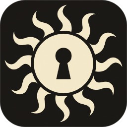

<p align="center">
  
</p>

<h1 align="center">BrightVault v0.7</h1>

<p align="center">
  <strong>Cofre pessoal criptografado em nuvem via vídeo óptico de alta densidade (YouTube)</strong><br/>
  Executável único para Windows · Criptografia Pós-Quântica em Cascata · Chaves por Pasta · Atualização Automática
  Este é um projeto aberto de estudos científicos sobre a compilação e resistência de dados após compressão e descompressão.
</p>

---

## Como baixar e usar (Windows)

Você **não precisa instalar Go, Python nem dependências manualmente**:

1. Baixe **`BrightVault.exe`** diretamente da página de **[Releases](https://github.com/brightbringer/BrightVault/releases)** (ou clique em **Code → Download ZIP** e extraia a pasta).
2. Dê **duplo clique em `BrightVault.exe`**.
3. O BrightVault inicia um servidor local seguro exclusivamente em `127.0.0.1` (com token aleatório por sessão) e abre automaticamente a interface desktop.
4. Na primeira abertura, crie seu cofre com sua **senha mestra** (e opcionalmente um **Arquivo-Chave 2º Fator**).

> **FFmpeg e yt-dlp:** para manter o executável compacto, `ffmpeg` e `yt-dlp` não são embutidos no `.exe`. Caso ainda não estejam instalados no seu PC, o próprio BrightVault exibe um botão **"Instalar Automaticamente"** em 1 clique na tela inicial.

---

## Principais Recursos

- **Criptografia Pós-Quântica em Cascata (*Zero-Knowledge*):** `Argon2id` + `HKDF-SHA512` + **AES-256-GCM + XChaCha20-Poly1305** com chaves independentes por pasta e por vídeo.
- **Chave própria por pasta + Compartilhamento seletivo:** cada pasta possui sua própria chave criptográfica guardada no seu cofre (aberta automaticamente pela sua senha mestra). Gere códigos de compartilhamento de pasta (`btfolder`) contendo apenas links e chaves dos arquivos daquela pasta.
- **Envio de Vídeos Ópticos (Dados Brutos ou Vídeo Artístico):**
  - Perfis de dados de alta densidade (`y8-gray`, `y6-gray`, `y4-gray`, `ycbcr-dual`, etc.) em até **4K**.
  - Modo **Vídeo Artístico / Stealth** com vídeo base opcional ou padrões fractais/generativos + trilha sonora generativa ou local.
  - Escolha o **nome personalizado do vídeo** antes de enviar (e renomeie direto no YouTube pela aba **🎬 Meus Vídeos**).
  - Privacidade configurável: **Público**, **Não Listado** ou **Privado**.
- **Integração com YouTube Data API v3:**
  - Envio automático, verificação de processamento, edição de privacidade/título, backup atômico do catálogo (**Vídeo-Índice**) e botão rápido **🔄 Reconectar YouTube** para renovar tokens expirados.
  - Também funciona 100% em **Modo Manual Assistido** sem precisar configurar API.
- **Painel Flutuante de Desempenho:** controle máximo de **% de CPU**, **% de RAM**, modo segundo plano e perfis rápidos (*Máximo*, *Equilibrado*, *Mínimo*).
- **Organização, Prévia e Sincronização Incremental:**
  - Pastas hierárquicas reordenáveis, coleções, tags, linha do tempo, edição de metadados em lote, prévia instantânea antes do download (*Manifest-First*) e vídeos de atualização incremental (cadeias delta).
- **Temas e Idiomas:** tema padrão **✨ Noite Brilhante**, além de *Noite*, *Papel*, *Deserto*, *Light*, *Rainbow* e *Crepúsculo*, em **9 idiomas** (PT, EN, ES, RU, FR, IT, JA, AR, ZH).
- **Atualizações Automáticas:** verifica novas versões no GitHub ao abrir e 1x por dia, exibindo o indicador de versão (`v0.7`) no topo com atualização automática em 1 clique.

---

## Comandos CLI (Opcional)

O mesmo `BrightVault.exe` pode ser usado via terminal:

```powershell
# Codificar arquivo ou pasta inteira em vídeo óptico criptografado
.\BrightVault.exe encode -in "C:\Pasta\Fotos" -out "backup.mp4" -pass "SuaSenhaForte" -res 2k -profile y8-gray

# Inspecionar conteúdo do vídeo sem baixar/decodificar tudo (Manifest-First)
.\BrightVault.exe peek -in "backup.mp4" -pass "SuaSenhaForte"

# Decodificar e restaurar com verificação SHA-256
.\BrightVault.exe decode -in "backup.mp4" -out ".\restaurado" -pass "SuaSenhaForte"
```

---

## Como compilar a partir do código-fonte

Requisitos: **Go 1.24+** (Windows 64-bit).

```powershell
.\build.ps1
```

Ou manualmente:

```powershell
$env:CGO_ENABLED = "0"
go build -ldflags="-H=windowsgui" -o BrightVault.exe ./cmd/ytcloud
```

---

## Aviso Importante

Utilizar o YouTube como repositório genérico de arquivos pode violar os Termos de Serviço da plataforma. **Nunca mantenha sua única cópia de arquivos insubstituíveis exclusivamente no YouTube** — siga sempre a regra de backup 3-2-1.

## Licença

Distribuído sob a licença MIT. Veja [LICENSE](LICENSE) para mais detalhes.
